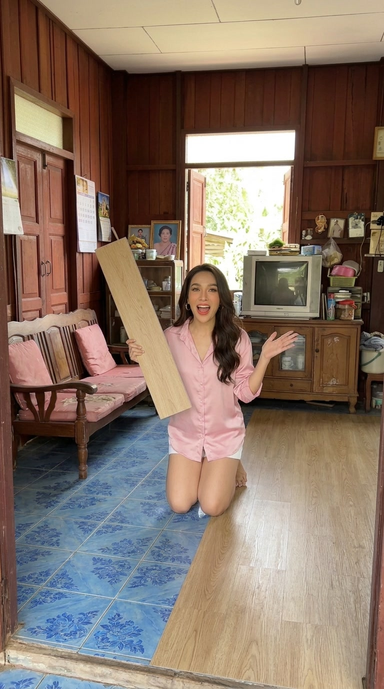
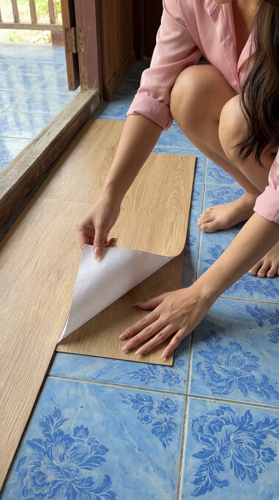
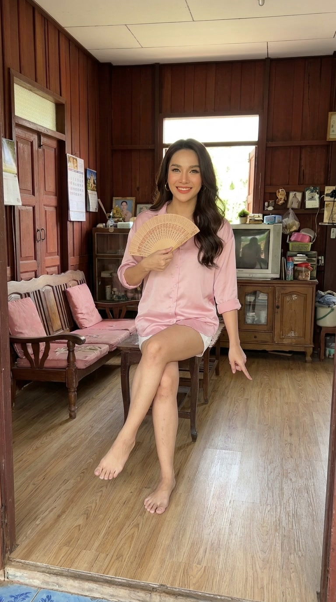
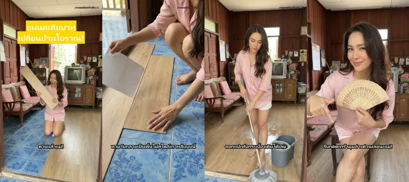

# sellshop — รีลป้ายยาสินค้าด้วย AI (พี่กะเทยเล่าเรื่อง)

ทำคลิปแนวตั้ง 9:16 ยาว ~20 วิ สำหรับขายสินค้า Affiliate (Shopee / TikTok Shop / Facebook Reels) ด้วยคำสั่งเดียว
- เริ่มจาก **ข้อมูลสินค้า**
- AI เขียน**บท + ฮุก + แคปชัน**
- **เสียงพากย์สไตล์พี่กะเทยเม้าท์มอย**
- **วิดีโอตัวละครหน้าเดิมทุกช็อต**
- ใส่ซับ ฮุก และป้าย "สร้างด้วย AI" อัตโนมัติ
- ได้ **แพ็กโพสต์** (แคปชัน + คำสั่ง Facebook API) พร้อมโพสต์

| ตัวละคร | เฟรมแรก 4 ช็อต | รีลที่ได้ |
|---|---|---|
|  |  | [examples/output/reel.mp4](examples/output/reel.mp4) <br> |

ตัวอย่างเสียง: [Puck](examples/voice-Puck.mp3) (ใช้ในรีล) · [Leda](examples/voice-Leda.mp3) · [Fenrir](examples/voice-Fenrir.mp3)

---

## ใช้อะไรบ้าง

| ส่วน | เครื่องมือ | ราคา |
|---|---|---|
| บท / ฮุก / แคปชัน / prompt ภาพ | Gemini (`gemini-3.8-flash`) ตอบเป็น JSON | ถูกมาก |
| เสียงพากย์ | Gemini TTS (`gemini-3.8-flash-tts`) + คำกำกับสไตล์ใน [voice-style.txt](voice-style.txt) | ฟรีวันละ 100 ครั้งต่อโมเดล (Tier 1) |
| ตัวละคร + เฟรมแรกของช็อต | Google Flow → Nano Banana | 0 เครดิต |
| วิดีโอแต่ละช็อต | Google Flow → Frames to Video (Omni 1.1 Flash) 720p 6 วิ | 10 เครดิต/ช็อต |
| (สำรอง) ภาพนิ่งแทนวิดีโอ | Gemini API Nano Banana (`gemini-3.1-flash-image`) | ไม่กี่บาท/ภาพ |
| ประกอบคลิป ซับ ความดังเสียง | ffmpeg (libass สำหรับซับไทย, loudnorm -14 LUFS) | ฟรี |
| โพสต์ | Facebook Graph API `/{page-id}/video_reels` (ตอนนี้เป็น dry run) | ฟรี |

ต้องมี **Node.js 18+**, **ffmpeg/ffprobe** ใน PATH, และ **GEMINI_API_KEY**

## เริ่มใช้

```bash
git clone https://github.com/jaroensakyod/sellshop.git
cd sellshop
cp .env.example .env        # ใส่ GEMINI_API_KEY ของคุณ (ไฟล์นี้ไม่ถูก commit)
node pipeline.mjs floor01 page-baan
```

ผลลัพธ์อยู่ที่ `out/page-baan__floor01/`: `plan.json`, `vo.wav`, `shots/`, `reel.mp4`, `post.json`

ทุกขั้นเก็บผลไว้ รันซ้ำจะข้ามขั้นที่เสร็จแล้ว ถ้าจะทำขั้นไหนใหม่ใช้ `FORCE=<ขั้น>` หรือจะรันขั้นเดียวก็ใส่ชื่อขั้นต่อท้าย:

```bash
node pipeline.mjs floor01 page-baan plan     # เฉพาะบท
FORCE=voice node pipeline.mjs floor01 page-baan voice   # อัดเสียงใหม่
FORCE=video node pipeline.mjs floor01 page-baan video   # ประกอบใหม่ (เช่น หลังใส่คลิป Flow)
```

## ไปป์ไลน์ทำอะไร

```
products.json ─┐
pages.json ────┴─▶ 1 plan ─▶ 2 voice ─▶ 3 shots ─▶ 4 video ─▶ 5 post
                   Gemini     Gemini TTS   Nano Banana  ffmpeg     post.json (dry run)
                   JSON       สไตล์กะเทย   / คลิป Flow   ซับ+ฮุก
```

1. **plan**: ส่งข้อมูลสินค้ากับมุมของเพจให้ Gemini ได้กลับมาเป็น
   - `hook` ไม่เกิน 30 ตัวอักษร สำหรับ 3 วิแรก
   - `vo` บทพากย์ 230–280 ตัวอักษร
   - `shots` prompt ภาษาอังกฤษช็อตละ 1 อัน (ช็อตแรกต้องเป็นภาพที่แรงที่สุด)
   - `caption` และ `hashtags`

   กฎในพรอมต์: ห้ามแต่งสรรพคุณเพิ่มจากข้อมูลสินค้า ห้ามคำหยาบ / กู / มึง ห้ามอ้างว่า "ใช้เองมาแล้วจริง" และเขียนตัวเลขเป็นคำไทย (ให้ TTS อ่านถูก)
2. **voice**: Gemini TTS เทคนิคอยู่ที่หัวข้อถัดไป
3. **shots**: ถ้ายังไม่มีคลิปวิดีโอ จะทำภาพนิ่งช็อตละรูป โดยใช้ช็อต 1 เป็นภาพอ้างอิงให้ช็อตที่เหลือ คนกับห้องจึงเหมือนเดิม
4. **video**:
   - ถ้ามี `out/…/clips/1.mp4 …` จะใช้คลิปวิดีโอ แต่ละคลิปตัดให้พอดีช่วงของมัน และทิ้งเสียงเดิมในคลิป ถ้าไม่มีจะใช้ภาพนิ่งที่ซูมช้าๆ
   - ใส่ฮุกตัวใหญ่ 3 วิแรก ซับทีละบรรทัด และป้าย "ภาพและเสียงสร้างด้วย AI"
   - ปรับเสียงเป็น -14 LUFS แล้วใส่ limiter กันเสียงแตก
5. **post**: เขียน `post.json` ไว้ ทั้งแคปชัน ลิงก์ แฮชแท็ก ข้อความ AI disclosure และคำสั่ง Graph API 3 ขั้น (start → upload → finish/scheduled) **ไม่มีอะไรถูกส่งออกไป**

## เทคนิคเสียง "พี่กะเทยเล่าเรื่อง"

คลิปต้นแบบใช้ **Voice Design** ใน Google AI Studio ซึ่งเรียกผ่าน API ไม่ได้ เราเลยใช้เสียงสำเร็จรูปของ Gemini TTS แล้วกำกับสไตล์ด้วยข้อความแทน:

```
<คำกำกับสไตล์ภาษาอังกฤษจาก voice-style.txt>

Transcript:
<บทภาษาไทย>
```

- ต้องมีบรรทัด **`Transcript:`** คั่น โมเดลจึงไม่อ่านคำกำกับออกเสียง ทดสอบแล้ว ให้ Gemini ฟังตรวจ ไม่มีคำกำกับหลุดออกมา
- `systemInstruction` **ใช้ไม่ได้** กับโมเดล TTS (ตอบกลับว่า "Developer instruction is not enabled for this model")
- เสียงที่ลองแล้ว: **Puck** (สาวสองเม้าท์ ได้ 9.5/10 จาก Gemini ตอนให้ฟังตรวจ) · Leda · Fenrir ลองเสียงอื่นด้วย
  ```bash
  node scripts/voice-test.mjs Zephyr test.wav
  ```
- บุคลิกส่วนใหญ่มาจาก**คำในบท** (ตายแล้วแม่ / แก / จ้า / แปะ แปะ แปะ) มากพอๆ กับเสียง
- โควตา TTS: วันละ ~100 ครั้งต่อโมเดล นับครั้งที่ถูกปฏิเสธด้วย สคริปต์บันทึกการใช้ไว้ใน `tts-quota.json` (คืนโควตาตอนเที่ยงคืนเวลาแปซิฟิก = 14:00/15:00 เวลาไทย)

## เทคนิคตัวละครหน้าเดิมทุกช็อต (วิดีโอ)

ขั้นตอนละเอียดอยู่ใน **[docs/FLOW.md](docs/FLOW.md)** สรุปสั้นๆ:
1. ทำรูปตัวละคร 1 ครั้งใน Flow (Nano Banana, 0 เครดิต)
2. ทำเฟรมแรกของแต่ละช็อต โดยแนบรูปตัวละครเป็น ingredient แล้วขึ้น prompt ด้วย *"Use the SAME woman, same outfit and same room as the reference image"*
3. ทำวิดีโอแบบ **Frames** จากเฟรมนั้น 6 วิ ช็อตละ 10 เครดิต ใน prompt ให้เขียนท่าเป็นลำดับ และใส่ *"She does not speak"*
4. ดาวน์โหลดด้วย [flow/flow-helpers.js](flow/flow-helpers.js) วางลงใน `out/…/clips/` แล้วสั่ง `FORCE=video`

prompt ตัวละครที่ใช้:
> Photoreal vertical phone video still, natural daylight. Full-body shot of a Thai katoey (transgender woman) in her early 30s, the lively big-sister type: long wavy dark-brown hair, glowing makeup with bold lashes and coral lipstick, gold hoop earrings, loose pastel-pink satin shirt, white shorts, barefoot. She stands in a Thai rural house living room with old blue floral ceramic floor tiles … one hand on her hip, the other hand up in a dramatic 'oh my god' gesture …

ช็อตที่ใช้ในตัวอย่าง: (1) ฮุก นั่งบนพื้นที่ปูไปครึ่งห้อง ทำหน้าตกใจ (2) เจาะมือลอกกระดาษแปะ (3) ถูพื้นแล้วยักคิ้ว (4) นั่งโซฟาโบกพัด ชี้ลงตะกร้า

## เพิ่มสินค้า / เพจ

**products.json**: ข้อมูลสินค้า (ตอนนี้เป็นตัวอย่าง ของจริงดึงจาก Affiliate API ได้)
```json
{ "id": "floor01", "name": "แผ่นพื้นไวนิลลายไม้ มีกาวในตัว", "price": 10, "unit": "แผ่น",
  "points": ["ลอกแปะทับกระเบื้องเดิมได้", "กันน้ำ"], "scene": "a Thai rural house living room …",
  "link": "https://…ลิงก์ affiliate…" }
```
`points` ใส่เฉพาะสิ่งที่สินค้ามีจริง เพราะ AI ถูกห้ามแต่งเพิ่ม

**pages.json**: แต่ละเพจมีมุมขาย (`angle`), เสียง (`voice`), ตัวละคร (`host`) และ `graphPageId` ของตัวเอง ถ้าทำหลายเพจ**ให้แต่ละเพจต่างกันจริง** อย่าก๊อปกัน

## ต้นทุนและการขยาย

ต่อ 1 คลิป: ข้อความ 1 ครั้ง + TTS 1 ครั้ง + **Flow 40 เครดิต** (4 ช็อต × 6 วิ)

| จำนวน | เครดิต Flow/วัน | TTS/วัน |
|---|---|---|
| 1 เพจ × วันละ 1 คลิป | 40 | 1 |
| 10 เพจ | 400 | 10 |
| 100 เพจ | 4,000 | 100 (เต็มโควตาฟรี) |

แนะนำให้**เริ่มเพจเดียว 2 สัปดาห์** โพสต์เองหลังดูคลิปทุกตัว แล้ววัดเปอร์เซ็นต์คนดูจบ ยอดคลิกลิงก์ ยอดขาย และแจ้งเตือนจากเพจ ผ่านแล้วค่อยเพิ่มเพจทีละเพจ แต่ละเพจใช้ตัวละครกับเสียงใหม่ จากนั้นค่อยให้ระบบโพสต์เอง ใช้ cron หรือ n8n เรียก `node pipeline.mjs <product> <page>` ต่อเพจต่อวัน

## กฎที่ต้องทำตาม
- **ติดป้าย AI**: ใส่ไว้ทั้งในคลิปและแคปชันแล้ว ตอนโพสต์ Facebook ให้เปิด "AI info" ด้วย
- **ห้ามรีวิวปลอม**: อย่าใช้คำว่า "ลองมาแล้ว" หรือ "ใช้เองจริง" กับคลิปที่ AI ทำ
- **ใส่ #ad / ลิงก์ Affiliate ให้ชัด**
- อย่าโพสต์คลิปเดียวกันซ้ำหลายเพจ เพราะจะโดนกดว่าเป็น "เนื้อหาไม่ต้นฉบับ" หรือ "เครือข่ายเพจ"
- **ห้าม commit API key หรือ token เพจ** (`.env` อยู่ใน .gitignore แล้ว)

## ที่ยังไม่ทำ (TODO)
- [ ] ดึงสินค้าจาก Shopee / TikTok Shop Affiliate API จริง
- [ ] สคริปต์ Flow อัตโนมัติเต็มขั้น ตอนนี้ยังกดผ่านเบราว์เซอร์ + helper
- [ ] ซับตรงคำ (จับเวลาคำจากเสียง) ตอนนี้แบ่งเวลาตามจำนวนตัวอักษร
- [ ] โพสต์จริงผ่าน Graph API + ตั้งเวลาแยกเพจ
- [ ] ความดังให้ถึง -14 LUFS พอดี (ตอนนี้ราว -15.8)
